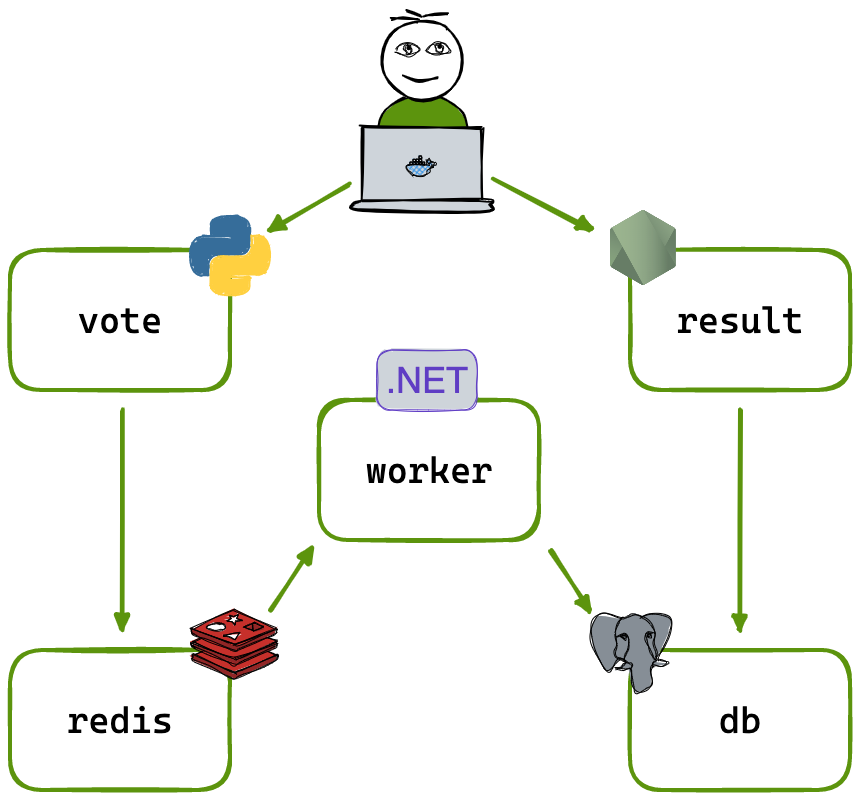
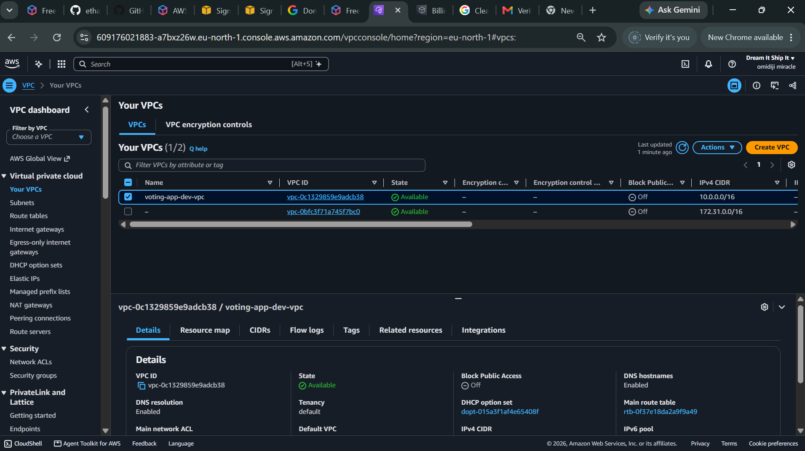
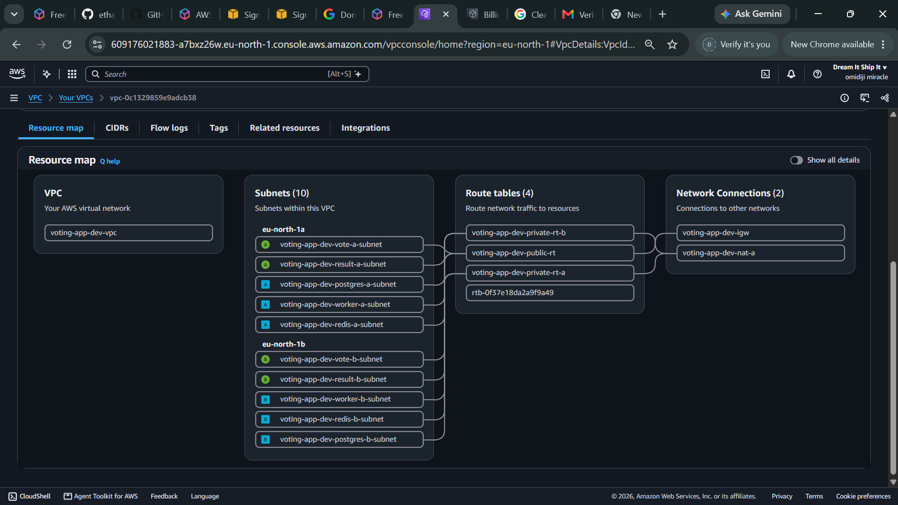
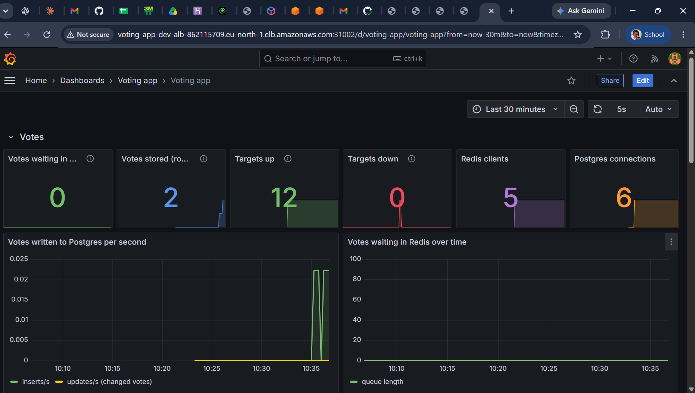

# Example Voting App: five-tier AWS deployment

This project extends a sample voting app into a five-tier deployment on AWS.
Terraform provisions the application and data servers across two Availability
Zones, plus a dedicated `m7i-flex.large` monitoring server when k3s is enabled.
An Application Load Balancer fronts the web tiers. Ansible deploys the
application with Docker Compose, k3s and Helm, or both:

```text
Browser -> ALB -> vote (Python) -> Redis -> worker (.NET) -> PostgreSQL
Browser <- ALB <- result (Node.js) <-----------------------------^
```

Vote, result, and worker servers are deployed in both Availability Zones.
Redis and PostgreSQL each run once in the first zone. With k3s enabled, a
ninth EC2 server in the first zone runs the monitoring workloads: Prometheus
and Grafana are scheduled to the dedicated `monitoring` node. The web tiers
are distributed, but the single Redis and PostgreSQL servers are not highly
available; this is a lab and demonstration architecture, not a production-ready
or fully fault-tolerant design.

## What this repository includes

| Area | Components |
|---|---|
| Application | Python vote app, .NET worker, Node.js results app, Redis queue, PostgreSQL database |
| Local development | Docker Compose, smoke test, optional prebuilt-image Compose file |
| Other deployment examples | Docker Swarm stack, Kubernetes manifests, Helm chart |
| AWS infrastructure | Terraform VPC, subnets, EC2 instances, NAT gateway, load balancer, security groups, and EC2 Instance Connect Endpoint |
| Configuration management | Ansible installs Docker and deploys Compose and/or k3s |
| CI workflows | Image build, tests, Trivy scans, image publishing, and Helm deployment workflows |

## Application architecture

The five tiers describe the roles of the application:

1. **Presentation:** the vote UI ([`vote/`](vote)) and results dashboard
   ([`result/`](result)).
2. **Application:** vote handling, result queries, and the .NET background
   worker ([`worker/`](worker)).
3. **Messaging:** Redis buffers submitted votes for asynchronous processing.
4. **Data:** PostgreSQL stores votes persistently.
5. **Deployment and infrastructure:** Docker, Kubernetes, Terraform, and
   Ansible run and operate the services.

The request flow is:

1. A user submits a vote through the vote app.
2. The vote app places it in Redis.
3. The worker consumes the queued vote and writes it to PostgreSQL.
4. The result app reads the vote totals from PostgreSQL and updates the
   dashboard.



## Run locally with Docker Compose

Install [Docker Desktop](https://www.docker.com/products/docker-desktop), or
Docker Engine and the Docker Compose plugin on Linux. Copy [`.env.example`](.env.example)
to `.env` and set a `POSTGRES_PASSWORD`, then start the development stack from
the repository root:

```shell
cp .env.example .env
# Edit .env and set POSTGRES_PASSWORD
docker compose up --build
```

Open:

- Vote app: <http://localhost:8082>
- Results app: <http://localhost:8081>

To submit a vote and verify that it reaches PostgreSQL:

```shell
VOTE_URL=http://localhost:8082 RESULT_URL=http://localhost:8081 \
DB_COUNT_CMD="docker compose exec -T db psql -U postgres -tAc 'select count(*) from votes'" \
scripts/smoke-test.sh
```

To run the prebuilt Docker images instead, use
[`docker-compose.images.yml`](docker-compose.images.yml). It exposes the vote
app on port `8080` and the results app on `8081`:

```shell
docker compose -f docker-compose.images.yml up -d
```

Stop the Compose stack with `docker compose down`.

## Deploy to AWS with Terraform and Ansible

The AWS deployment creates a VPC with eleven subnets, nine Ubuntu EC2 servers
when k3s is enabled (eight application/data servers and one monitoring server),
an internet-facing Application Load Balancer, and an EC2 Instance Connect
Endpoint for SSH access. The monitoring server is private and uses
`m7i-flex.large`; the Compose-only mode does not create it. The default
Terraform configuration uses one NAT gateway to reduce cost; set
`single_nat_gateway = false` in the tfvars file to use one NAT gateway per AZ.






Terraform provisions the infrastructure and, with `run_ansible = true`,
automatically runs Ansible to install Docker and deploy the selected mode:

- `compose`: one Compose service per application/data server, assigned to its
  tier.
- `k3s`: one k3s cluster across the application, data, and monitoring servers;
  Helm schedules pods to their corresponding tier.
- `both`: deploy both modes side by side. They have separate URLs and app data.

The repository currently sets `deploy_method = "both"` in
[`terraform/terraform.tfvars`](terraform/terraform.tfvars).

### AWS prerequisites

- An AWS account and credentials with permissions to create the listed
  networking, EC2, load-balancing, and EC2 Instance Connect resources.
- Terraform `>= 1.10.0` (the S3 backend uses native lock-file locking).
- AWS CLI v2, including `aws ec2-instance-connect open-tunnel`, for SSH access
  through the Instance Connect Endpoint.
- An existing EC2 key pair, or set `create_key_pair = true` and provide a public
  key path.
- An S3 bucket for the Terraform backend. The current backend configuration in
  [`terraform/backend.tf`](terraform/backend.tf) names a bucket; create and
  secure a bucket you control, and update that configuration if necessary.
- Ansible Core on the machine running Terraform:
  `pipx install ansible-core`.

Review the defaults in [`terraform/terraform.tfvars`](terraform/terraform.tfvars)
before deployment. In particular, set `github_owner` to the GitHub account or
organization that owns your GHCR images, and verify the AWS region,
Availability Zones, SSH key settings, and allowed application CIDRs. The AMI
filter selects Canonical Ubuntu 24.04 x86_64 images.

Terraform state contains sensitive values, including the generated database
password. Keep the S3 bucket private and encrypted, enable versioning, and
never commit state files, AWS credentials, or private SSH keys.

### Apply and inspect the deployment

```shell
cd terraform
terraform init
terraform fmt -check
terraform validate
terraform plan
terraform apply
terraform output
```

The outputs include the ALB URLs, server addresses, and SSH commands. By
default, Compose uses the ALB on ports `80` (vote) and `8081` (results). The
k3s/Helm endpoints use ports `31000` (vote), `31001` (results), and `31002`
(Grafana). Grafana's NodePort is served by the k3s cluster and its pod is
scheduled onto the dedicated monitoring server. The database and Redis ports
are not exposed through the ALB.

Terraform also has an automated GitHub Actions workflow at
[`.github/workflows/terraform.yml`](.github/workflows/terraform.yml). To use
it, configure repository secrets `AWS_ACCESS_KEY_ID`,
`AWS_SECRET_ACCESS_KEY`, and `EC2_SSH_PRIVATE_KEY`. The workflow runs on
relevant infrastructure changes pushed to `main` or by manual dispatch. The
CI/CD workflow currently has only a manual trigger; its push-to-`main`
application build and deployment trigger is commented out. Review and enable
the intended triggers in
[`.github/workflows/ci-cd.yml`](.github/workflows/ci-cd.yml)
before relying on automatic application deployments.

### SSH to a server and run Ansible again

Terraform's `ssh_commands` output includes a command for each server. These
commands use the EC2 Instance Connect Endpoint, so AWS CLI credentials and
permissions are required. The `k3s` control plane is on `worker-a`.

To rerun Ansible manually after changing its generated variables:

```shell
cd ansible
ansible-playbook playbook.yml -e @vars.generated.yml
```

Generated inventory and variable files are local deployment artifacts; do not
commit them.

### Destroy the AWS deployment

Destroy the resources when the environment is no longer needed to avoid
ongoing charges:

```shell
cd terraform
terraform destroy
```

## Deploy with Docker Swarm

Initialize a swarm if needed, then deploy the stack:

```shell
docker swarm init
docker stack deploy --compose-file docker-stack.yml vote
```

## Deploy with Kubernetes manifests

The [`k8s-specifications/`](k8s-specifications) directory contains Kubernetes
Deployments and Services:

```shell
kubectl apply -f k8s-specifications/
kubectl get pods
kubectl get svc
```

The vote and result services use NodePorts `31000` and `31001`. Remove the
resources with:

```shell
kubectl delete -f k8s-specifications/
```

## Deploy with Helm

The chart in [`helm/voting-app/`](helm/voting-app) deploys vote, result, worker,
Redis, PostgreSQL, and optional Prometheus/Grafana monitoring. For the AWS
five-tier cluster, use [`values-5tier.yaml`](helm/voting-app/values-5tier.yaml),
which pins workloads to their tier nodes, schedules both monitoring pods onto
the dedicated `monitoring` server, and spreads replicated web and worker pods
across hosts.

The database password is provided as a Kubernetes Secret, not stored in the
chart. In a cluster where Ansible has not already created the Secret, create it
from a protected password file:

```shell
kubectl create secret generic voting-db \
  --from-file=POSTGRES_PASSWORD=/secure/path/to/password-file
```

Install or upgrade the chart, replacing `YOUR_GITHUB_USERNAME` with the GHCR
owner of the images:

```shell
helm upgrade --install voting ./helm/voting-app \
  -f ./helm/voting-app/values-5tier.yaml \
  --set image.registry=ghcr.io/YOUR_GITHUB_USERNAME \
  --set image.tag=latest
```

The expected image names are:

- `example-voting-app-5tier-vote`
- `example-voting-app-5tier-result`
- `example-voting-app-5tier-worker`

For the k3s deployment, the ALB forwards to vote on port `31000`, results on
`31001`, and Grafana on `31002`. Manage the release with:

```shell
helm history voting
helm rollback voting REVISION
helm uninstall voting
```

Replace `REVISION` with a revision from `helm history`. The CI/CD workflow uses
Helm's `--atomic` option, which automatically rolls back a failed upgrade.

## Monitoring

The Helm chart enables Prometheus and Grafana by default. Both are scheduled on
the dedicated `m7i-flex.large` monitoring server in the k3s deployment. Grafana
is available through the load balancer on port `31002`; Prometheus remains
internal to the cluster. Grafana's initial admin password is generated during
install and stored in the Kubernetes Secret `grafana-admin`; do not commit or
share the password. Retrieve it with appropriate cluster access:


```shell
kubectl get secret grafana-admin \
  -o jsonpath='{.data.admin-password}' | base64 --decode; echo
```

The dashboard and Prometheus retain metrics in pod-local storage for three
days. Monitoring does not provide alerting, durable metrics storage, or
application request/latency metrics.

## Project layout

- [`vote/`](vote) - Python vote frontend
- [`result/`](result) - Node.js results dashboard
- [`worker/`](worker) - .NET queue consumer
- [`helm/voting-app/`](helm/voting-app) - Kubernetes Helm chart and values
- [`k8s-specifications/`](k8s-specifications) - Kubernetes manifests
- [`terraform/`](terraform) - AWS infrastructure as code
- [`ansible/`](ansible) - host and application deployment automation
- [`scripts/`](scripts) - smoke-test and rollback-demo scripts
- [`deployment.md`](deployment.md) - deployment notes

## Notes and limitations

- The app accepts one vote per client browser; a later vote from that browser
  updates its existing vote.
- Redis and PostgreSQL each run on a single server in one Availability Zone.
  Their failure interrupts vote processing or results, and the database does
  not have managed backups or multi-AZ failover configured.
- The AWS deployment uses HTTP unless you add a domain name and configure TLS.
  Restrict the allowed application CIDRs if the demo should not be publicly
  reachable.
- This is an educational example of a distributed application and deployment
  automation, not a complete production architecture.
