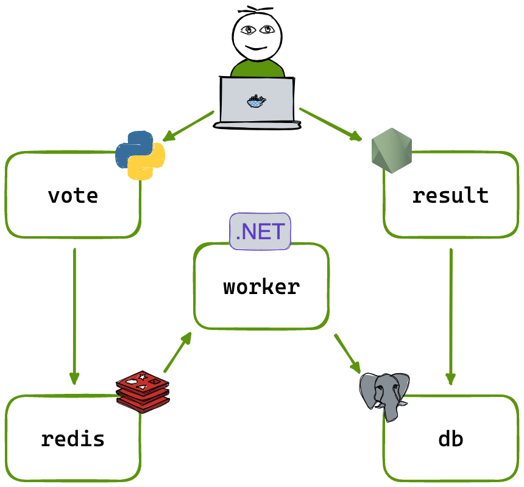

# Example Voting App

A small distributed voting application composed of Python, Node.js, .NET,
Redis, and PostgreSQL. The application demonstrates a vote frontend, an
asynchronous worker, and a live results frontend.

## Application architecture



- **Vote**: Python web application where users choose between two options.
- **Redis**: queue for newly submitted votes.
- **Worker**: .NET service that reads votes from Redis and writes them to
  PostgreSQL.
- **PostgreSQL**: persistent vote store.
- **Result**: Node.js application that displays the current results.

## Run locally with Docker Compose

Install [Docker Desktop](https://www.docker.com/products/docker-desktop), or
install Docker Engine and the Docker Compose plugin on Linux. From the
repository root, run:

```shell
docker compose up
```

The development Compose file builds the services locally. Open:

- Vote: <http://localhost:8082>
- Results: <http://localhost:8081>

To run the pre-built Docker images instead:

```shell
docker compose -f docker-compose.images.yml up -d
```

The pre-built image deployment uses ports `8080` (vote) and `8081` (results).
To stop either deployment, run `docker compose down`.

## Single-tier AWS deployment with Terraform and Ansible

This repository includes a one-tier AWS deployment intended for a lab,
demonstration, or small non-production environment. Terraform creates one
Ubuntu EC2 instance in one public subnet and assigns it an Elastic IP.
Ansible then installs Docker and deploys the application with Docker Compose.


The deployment consists of:

```text
Internet
   |
Elastic IP
   |
VPC -> public subnet -> EC2 instance
                          ├── vote
                          ├── result
                          ├── worker
                          ├── Redis
                          └── PostgreSQL + persistent Docker volume
```

The default deployment is Docker Compose:

- Vote page: `http://<elastic-ip>:8080`
- Results page: `http://<elastic-ip>:8081`

The security group exposes only the configured application ports and SSH.
Redis (`6379`) and PostgreSQL (`5432`) remain internal to the server. The
same Terraform configuration can optionally install single-node k3s and apply
the manifests in [`k8s-specifications/`](k8s-specifications), using ports
`31000` and `31001`.

### Prerequisites

Install and configure:

- An AWS account and credentials available to the AWS provider.
- Terraform `>= 1.5.0`.
- An existing EC2 key pair, or a public key if
  `create_key_pair = true`.
- Ansible Core on the machine running Terraform:
  `pipx install ansible-core`.

The configured AWS region defaults to `eu-north-1`. The AMI filter currently
targets Canonical Ubuntu 26.04 x86_64 images; change
`ami_name_filter` in [`terraform/terraform.tfvars`](terraform/terraform.tfvars)
if the selected region does not provide that image.

The Terraform backend uses an existing S3 bucket configured in
[`terraform/backend.tf`](terraform/backend.tf). Create that bucket first, or
change the backend configuration to a bucket you control. Do not commit AWS
credentials, private keys, or Terraform state.

### Deploy

1. Review the values in [`terraform/terraform.tfvars`](terraform/terraform.tfvars).
   In particular, set `key_name`, `ssh_private_key_path`, and restrict
   `ssh_allowed_cidrs` to your own administration network where possible.
2. Initialize and validate Terraform:

   ```shell
   cd terraform
   terraform init
   terraform fmt -check
   terraform validate
   ```

3. Review and apply the plan:

   ```shell
   terraform plan
   terraform apply
   ```

   `run_ansible = true` causes Terraform to generate the Ansible inventory and
   variables, wait for SSH, install Docker, start the Compose stack, and wait
   for both web applications to respond.

4. Print the URLs and connection details:

   ```shell
   terraform output
   ```

   Useful outputs include `vote_url`, `result_url`, `public_ip`, and
   `ssh_command`.

To deploy k3s instead of Compose, set `deploy_method = "k3s"` and apply again.
Use `"both"` to deploy both modes, but choose non-overlapping ports if both
applications are exposed at the same time.

### Re-running Ansible

Terraform normally runs Ansible when the server, deployment method, images, or
deployment files change. To run it manually after changing the generated
variables:

```shell
cd ansible
ansible-playbook playbook.yml -e @vars.generated.yml
```

The generated files `ansible/inventory.ini` and
`ansible/vars.generated.yml` are local deployment artifacts and should not be
committed.

### Remove the AWS resources

When the environment is no longer needed, destroy the resources to avoid
ongoing AWS charges:

```shell
cd terraform
terraform destroy
```

### Scope and production limitations

This is deliberately a **single-tier** deployment, not a highly available
production architecture. It has one EC2 instance, one Availability Zone, a
publicly reachable host, and PostgreSQL data stored on the instance's EBS
volume. It does not provide an Application Load Balancer, managed RDS,
multi-AZ failover, autoscaling, backups, TLS termination, or zero-downtime
deployments. Add those services and controls before using the design for
production workloads.

## Run the app in Docker Swarm

Initialize a swarm if necessary:

```shell
docker swarm init
```

Deploy the stack:

```shell
docker stack deploy --compose-file docker-stack.yml vote
```

## Run the app in Kubernetes

The [`k8s-specifications/`](k8s-specifications) directory contains Kubernetes
Deployments and Services for the voting app:

```shell
kubectl apply -f k8s-specifications/
kubectl get pods
kubectl get svc
```

The vote app is available on port `31000` and the results app on port `31001`
when the services are exposed through their configured NodePorts.

Remove the resources with:

```shell
kubectl delete -f k8s-specifications/
```

## Notes

The voting application accepts one vote per client browser. Additional votes
from the same browser are ignored.

This is an educational example of a distributed application and is not
intended to be a complete production architecture.
